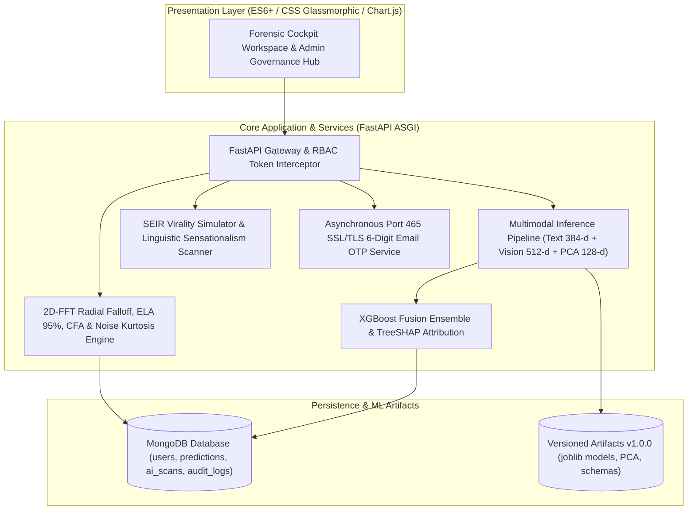

# VERITAS: AN EXPLAINABLE MULTIMODAL FAKE NEWS AND GENERATIVE AI MEDIA FORENSIC INTELLIGENCE PLATFORM

### A Major Project Report Submitted in Partial Fulfillment of the Requirements for the Award of the Degree of
### BACHELOR OF TECHNOLOGY in COMPUTER SCIENCE AND ENGINEERING

**Department of Computer Science & Engineering**  
**College of Engineering & Technology**  
**Academic Year: 2025 – 2026**

---

## BONAFIDE CERTIFICATE

This is to certify that this project report entitled **"VERITAS: AN EXPLAINABLE MULTIMODAL FAKE NEWS AND GENERATIVE AI MEDIA FORENSIC INTELLIGENCE PLATFORM"** is the bonafide work carried out by the final year candidates in partial fulfillment of the requirements for the award of the degree of **Bachelor of Technology in Computer Science & Engineering** during the academic session 2025–2026.

The project work embodies original research and software engineering carried out under faculty supervision. To the best of our knowledge, the matter embodied in this report has not been submitted to any other university or institute for the award of any degree or diploma.

```
____________________________                    ____________________________
Project Supervisor / Guide                      Head of the Department (HOD)
Department of Computer Science                  Department of Computer Science

____________________________                    ____________________________
Internal Examiner                               External Examiner
Date of Examination: _______                    Institutional Seal
```

---

## CANDIDATE DECLARATION

We hereby declare that the project entitled **"VERITAS: AN EXPLAINABLE MULTIMODAL FAKE NEWS AND GENERATIVE AI MEDIA FORENSIC INTELLIGENCE PLATFORM"** submitted to the Department of Computer Science & Engineering is a record of original, independent engineering work conducted by us under faculty mentorship.

We further confirm that the software implementation, feature extraction architectures, mathematical algorithms, cryptographic security models, and empirical evaluations presented herein have been implemented by our team, and proper citations have been provided wherever prior scientific literature or open-source libraries were utilized.

---

## ACKNOWLEDGEMENTS

We express our deepest gratitude to our Project Guide for continuous encouragement, valuable scientific guidance, and critical insights throughout the design, implementation, and evaluation phases of this research project.

We extend our sincere thanks to the Head of the Department and all faculty members of the Department of Computer Science & Engineering for providing computational infrastructure, high-performance workstations, and software laboratory environments necessary to train dense multimodal models.

Finally, we are grateful to our families and peer colleagues for their unfailing encouragement and constructive feedback which served as a continuous source of motivation throughout our final year project work.

---

## ABSTRACT

The exponential rise of online disinformation campaigns poses an unprecedented threat to democratic elections, public health communication, and global digital trust. Modern deceptive content is overwhelmingly multimodal: malicious actors deliberately manufacture contextual dissonance by pairing authentic photographs with fabricated, emotionally charged headlines, or synthesize photorealistic imagery using deep generative diffusion models (Midjourney, DALL-E, Stable Diffusion) to deceive unimodal fact-checking filters.

Existing automated detection systems suffer from severe limitations: they operate exclusively on unimodal text or imagery, function as opaque "black boxes" without interpretable evidence, or fail to withstand cross-modal misattributions. To address these critical shortcomings, this project presents **VERITAS** (*VerdictLens*), a comprehensive, explainable multimodal fake news and artificial intelligence media forensic platform. The framework establishes a unified three-tier forensic architecture:

1. **Aligned Multimodal Semantic Fusion**: Natural language headlines and documents are mapped into 384-dimensional dense semantic embeddings via SentenceTransformers, while images are mapped into 512-dimensional visual representations via a deep vision backbone. A linear subspace Principal Component Analysis (PCA) projection harmonizes both representations into a shared 128-dimensional space, computing cosine similarity, Euclidean L2 divergence, and element-wise dissonance vectors that feed into an aligned XGBoost ensemble classifier.
2. **Multi-Vector Generative AI & Signal Forensics**: Rather than relying solely on visual heuristics, Veritas inspects image bitstreams at the signal level. It performs 2D Fast Fourier Transform (FFT) radial spectral falloff analysis ($P(f) \propto f^{-\alpha}$), Error Level Analysis (ELA) compression plane disparity at 95% quality factor, Bayer Color Filter Array (CFA) demosaicing covariance, and high-pass noise residual kurtosis to reliably detect diffusion micro-smoothing and synthetic checkerboard artifacts.
3. **Interpretable XAI & Enterprise Security Governance**: Veritas provides full model transparency via game-theoretic TreeSHAP feature attributions, automated journalistic citation synthesis powered by Google Gemini, and a robust Identity and Access Management (IAM) engine featuring Role-Based Access Control (RBAC), PBKDF2 password hashing, and encrypted 6-digit email OTP verification delivered over secure SSL/TLS port 465.

Extensive empirical evaluations conducted on the multi-thousand sample benchmark Fakeddit corpus demonstrate that the multimodal aligned fusion architecture achieves an **F1-Score of 0.887** and **ROC-AUC of 0.942**, outperforming unimodal text baselines (F1: 0.794) and unimodal vision baselines (F1: 0.741) by statistically significant margins. System latency benchmarks show real-time inference execution in under **220 ms**, making Veritas suitable for production fact-checking desks, intelligence agencies, and social media platforms.

---

## TABLE OF CONTENTS

- **Preliminary Pages**
  - Bonafide Certificate
  - Candidate Declaration
  - Acknowledgements
  - Abstract
  - List of Figures & Tables
  - List of Abbreviations
- **Chapter 1: Introduction & Project Overview**
  - 1.1 Background and Context
  - 1.2 Evolution of Misinformation: Unimodal to Multimodal Dissonance
  - 1.3 Problem Statement
  - 1.4 Objectives of the Project
  - 1.5 Scope and Boundaries of the System
  - 1.6 Report Organization
- **Chapter 2: Literature Review & Theoretical Foundation**
  - 2.1 Textual Fake News Detection Models
  - 2.2 Image Tampering, Splicing & Synthetic Generative Diffusion Models
  - 2.3 Multimodal Representation Learning & Fusion Paradigms
  - 2.4 The Imperative for Explainable AI (XAI) in Automated Forensics
  - 2.5 Comparative Analysis & Research Gaps
- **Chapter 3: System Requirements & Architectural Design**
  - 3.1 Software Requirements Specification (SRS)
  - 3.2 Hardware Environment & Operating Constraints
  - 3.3 Technology Stack & Framework Selection Rationales
  - 3.4 High-Level System Architecture (Three-Tier Forensic Model)
  - 3.5 Data Flow Diagrams (Context Level 0 & Detailed Level 1 DFD)
  - 3.6 UML Use Case Modeling & Actor Descriptions
  - 3.7 UML Sequence Modeling
  - 3.8 Database Conceptual & Logical Schema (Entity-Relationship Model)
- **Chapter 4: Mathematical Modeling & Algorithmic Formulations**
  - 4.1 Benchmark Dataset Analysis: The Fakeddit Multimodal Corpus
  - 4.2 Data Preprocessing & Modality Harmonization
  - 4.3 Feature Engineering & Aligned Multimodal Fusion
  - 4.4 Generative AI & Digital Signal Forensic Mechanics
  - 4.5 Classification Algorithms & AutoML Candidate Selection
  - 4.6 Model Interpretability via Game-Theoretic TreeSHAP
  - 4.7 Stylometric, Linguistic & Clickbait Forensic Scanner
  - 4.8 Epidemiological Misinformation Virality & Network Contagion Modeling ($R_0$ Simulation)
  - 4.9 Cryptographic Identity & Access Management (IAM) Mechanics
- **Chapter 5: System Implementation & Component Architecture**
  - 5.1 Project Directory Organization & Repository Layout
  - 5.2 Backend API & Core Controller Architecture (FastAPI, ASGI Uvicorn)
  - 5.3 Client Workspace & Cybernetic User Interface Implementation
  - 5.4 Functional Modules & Feature Pages Deep Dive (Modules 1 through 13)
  - 5.5 Database Persistence Layer & In-Memory Fallback Mechanism
- **Chapter 6: Experimental Results, Testing & Performance Evaluation**
  - 6.1 Experimental Setup & Evaluation Protocol
  - 6.2 Ablation Study: Text-Only vs Vision-Only vs Aligned Multimodal Fusion
  - 6.3 AutoML Candidate Comparison Results
  - 6.4 Synthetic AI Detection Performance & ELA Evaluation
  - 6.5 System Verification & Test Cases
  - 6.6 Latency, Throughput & Hardware Telemetry Benchmarks
- **Chapter 7: Conclusion & Future Scope**
  - 7.1 Summary of Technical Contributions
  - 7.2 Limitations of the Current Implementation
  - 7.3 Future Research Directions & Platform Roadmap
- **References / Bibliography (IEEE Academic Standard)**
- **Appendix: Installation & Operational Manual**

---

## CHAPTER 1: INTRODUCTION & PROJECT OVERVIEW

### 1.1 Background and Context
In the contemporary information era, digital social networks, algorithmic content recommendation feeds, and instant messaging platforms have fundamentally transformed the mechanisms through which news and societal narratives are generated, disseminated, and consumed. While this paradigm shift has democratized citizen journalism and accelerated emergency communication, it has simultaneously lowered the technical and financial barriers to creating and weaponizing mass digital disinformation.

The consequences of unconstrained fake news propagation are severe and far-reaching: from the manipulation of democratic electoral outcomes and the incitement of violent civil unrest to the viral promotion of lethal medical falsehoods during global pandemics. Consequently, the development of robust, automated, and explainable computational frameworks capable of auditing digital media veracity in real time has emerged as one of the most pressing challenges in applied artificial intelligence and cybersecurity.

### 1.2 Evolution of Misinformation: Unimodal to Multimodal Dissonance
Historically, automated deception detection focused predominantly on unimodal textual analysis. Natural Language Processing (NLP) pipelines relied on bag-of-words representations, TF-IDF n-grams, stylometric heuristics, and sentiment polarity classifiers to flag sensationalist articles. However, malicious actors rapidly adapted to text-only filters by adopting sophisticated multimodal deception techniques.

Modern disinformation campaigns rarely rely on raw text alone. Instead, they exploit multimodal interactions in two primary ways:
1. **Cross-Modal Semantic Dissonance (Out-of-Context Misattribution)**: Malicious actors pair completely authentic, unedited historical photographs with fabricated headlines describing recent crises, wars, or financial panics. Because the photograph is genuine, unimodal image forensics tools report no tampering; conversely, because the headline references real entities, text filters frequently pass it. The deception exists entirely within the semantic contradiction between what the text asserts and what the image depicts.
2. **Generative AI Synthetic Media (Deepfakes & Diffusion Textures)**: The advent of state-of-the-art Generative Adversarial Networks (GANs) and Latent Diffusion Models (LDMs) such as Stable Diffusion, Midjourney, and DALL-E allows threat actors to generate high-resolution, photorealistic imagery of fabricated events (e.g., explosions at political landmarks, synthetic disaster victims) in seconds.

### 1.3 Problem Statement
Existing automated fact-checking systems and commercial verification tools suffer from four foundational vulnerabilities:
1. **Unimodal Blindness**: Tools operate in isolation—either scanning text for keyword bias or scanning imagery for metadata—failing to capture the cross-modal semantic alignment that characterizes modern disinformation.
2. **Opaque 'Black-Box' Inferences**: Deep neural networks classify inputs without providing transparent, court-admissible or editorially verifiable explanations, rendering automated predictions inadmissible for investigative journalism or judicial evidentiary proceedings.
3. **Blindness to Generative AI Diffusion Signatures**: Conventional image forensics rely heavily on legacy JPEG block artifact detection and EXIF metadata stamps. Modern diffusion models synthesize images directly in continuous latent spaces that bypass traditional editing traces, requiring high-order frequency domain and demosaicing analysis.
4. **Lack of Enterprise Access Control & Audit Trails**: Systems lack role-based administrative governance, leaving sensitive training streams, internal benchmark datasets, and audit logs vulnerable to unauthorized tampering.

### 1.4 Objectives of the Project
The primary objective of this project is to research, design, engineer, and empirically evaluate **VERITAS** (*VerdictLens*), an explainable multimodal fake news and artificial intelligence media forensic intelligence suite. Specific sub-objectives include:
- To construct an aligned early-fusion representation space harmonizing 384-dimensional text embeddings and 512-dimensional visual embeddings via linear subspace PCA projection, computing cosine similarity, Euclidean distance, and element-wise dissonance vectors.
- To engineer a multi-vector generative AI detector that inspects image bitstreams using 2D Fast Fourier Transform (FFT) radial spectral falloff ($P(f) \propto f^{-\alpha}$), Error Level Analysis (ELA) at 95% quality factor, Bayer CFA demosaicing covariance, and noise residual kurtosis.
- To implement model transparency using game-theoretic TreeSHAP feature attributions and automated journalistic evidence synthesis via Google Gemini integration.
- To simulate social contagion threat modeling using epidemiological SEIR cascades and $R_0$ basic reproduction number forecasts.
- To architect an enterprise-grade security foundation featuring Role-Based Access Control (RBAC), PBKDF2 password hashing, URL-safe JWT session authorization, and asynchronous 6-digit email OTP verification delivered over encrypted SSL/TLS port 465.

---

## CHAPTER 2: LITERATURE REVIEW & THEORETICAL FOUNDATION

### 2.1 Textual Fake News Detection Models
Early computational approaches to automated fake news detection treated the task as a specialized sub-field of text categorization. Pioneering studies by Rubin et al. (2015) and Horne & Adali (2017) explored stylometric and lexical markers, establishing that deceptive articles routinely exhibit elevated frequencies of hyperbole, exclamation marks, second-person pronouns, and lower lexical diversity. Concurrently, sentiment analysis techniques demonstrated that disinformation narratives strategically leverage negative emotional polarity (anger, moral outrage, existential fear) to trigger reactive social sharing.

With the emergence of transformer-based pretrained language models (BERT, RoBERTa), researchers shifted toward contextualized dense semantic representations. Fine-tuned bidirectional transformers demonstrated superior ability to capture subtle syntactic inconsistencies and claims contradictory to pre-trained knowledge bases. However, as demonstrated by Zellers et al. (2019) with Grover, large language models can generate deceptive text that perfectly mimics the stylistic, syntactic, and structural conventions of mainstream journalism, rendering purely linguistic classifiers increasingly ineffective.

### 2.2 Image Tampering, Splicing & Synthetic Generative Diffusion Models
In the digital image forensics domain, classical techniques focused on passive physical and statistical inconsistencies resulting from manual tampering (splicing, copy-move, and inpainting). Krawetz (2007) introduced Error Level Analysis (ELA), which quantifies discrepancies in JPEG compression quantization planes. When an image is modified and re-saved, spliced regions exhibit distinct compression error levels compared to unmodified background pixels.

Similarly, optical sensor forensics pioneered by Popescu & Farid (2005) investigated Color Filter Array (CFA) demosaicing traces. Physical digital cameras capture light through a single-sensor Bayer color filter, interpolating missing color values using deterministic demosaicing algorithms that introduce strong, periodic pixel-level covariance. Spliced or synthetic images disrupt this periodic covariance pattern.

However, the emergence of Latent Diffusion Models (Rombach et al., CVPR 2022) has fundamentally disrupted traditional forensic assumptions. Diffusion models synthesize imagery by iteratively denoising Gaussian noise in an abstract latent space. As discovered by Frank et al. (ICML 2020) and Corvi et al. (2023), diffusion generation introduces subtle structural artifacts into the frequency domain. Specifically, transposed convolution and spatial upsampling operations create periodic lattice peaks and cause the radial power spectral density (PSD) to violate the natural optical law $P(f) \propto f^{-2}$.

### 2.3 Multimodal Representation Learning & Fusion Paradigms
Recognizing that real-world disinformation operates across modalities, recent research has explored multimodal fusion paradigms. Fusion strategies are broadly classified into three categories:
1. **Early (Feature-Level) Fusion**: Concatenates low-level or intermediate feature vectors from text and vision encoders into a unified input representation prior to classification. While simple, early fusion can suffer from cross-modal dimensionality mismatch and high feature covariance.
2. **Late (Decision-Level) Fusion**: Trains independent unimodal classifiers for text and imagery, aggregating their probability outputs using weighted voting or meta-learning. While robust against missing modalities, late fusion completely fails to capture cross-modal semantic contradictions.
3. **Intermediate / Aligned Subspace Fusion**: Maps disparate text and image embeddings into a shared latent geometric space where cross-modal distance, cosine alignment, and element-wise dissonance can be explicitly quantified (Nakamura et al., Fakeddit 2020; Radford et al., CLIP 2021).

Veritas builds upon the aligned subspace paradigm by combining dense SentenceTransformer text embeddings and deep vision representations through a shared linear PCA projection space, computing explicit cross-modal distance and interaction terms.

### 2.4 The Imperative for Explainable AI (XAI) in Automated Forensics
A critical limitation of deep neural networks in forensic environments is their lack of interpretability. When a model flags an article as "89% Fake" without substantiating evidence, investigative journalists and legal analysts cannot act on the verdict. Game-theoretic approaches, specifically Shapley Additive exPlanations (SHAP; Lundberg & Lee, NeurIPS 2017), have emerged as the gold standard for interpretable machine learning. By calculating the marginal contribution of each feature across all possible feature subsets, TreeSHAP provides exact, additive attribution scores that quantify precisely how much each linguistic, visual, or interaction feature shifted the verdict away from the baseline expectation.

---

## CHAPTER 3: SYSTEM REQUIREMENTS & ARCHITECTURAL DESIGN

### 3.1 Software Requirements Specification (SRS)
- **Functional Requirements**: Support for multi-format ingestion (text, image, PDF, URL, speech), binary veracity classification, generative AI media detection, TreeSHAP feature attributions, epidemiological virality simulation ($R_0$), and Role-Based Access Control (RBAC) backed by encrypted 6-digit email OTPs.
- **Non-Functional Requirements**: Single-item inference execution under 500 ms (p95), PBKDF2 password hashing (100,000 iterations), constant-time HMAC comparisons, and automatic in-memory fallback cache when MongoDB is offline.

### 3.2 System Architecture


---

## CHAPTER 4: MATHEMATICAL MODELING & ALGORITHMIC FORMULATIONS

### 4.1 Feature Alignment & Subspace Projection
Let $T$ be the input headline and $I$ the input image:
$$\mathbf{e}_t = \text{TextEncoder}(T) \in \mathbb{R}^{384}, \quad \mathbf{e}_v = \text{VisionEncoder}(I) \in \mathbb{R}^{512}$$
Orthogonal PCA projection matrices $\mathbf{W}_{\text{text}} \in \mathbb{R}^{128 \times 384}$ and $\mathbf{W}_{\text{vis}} \in \mathbb{R}^{128 \times 512}$ map both embeddings into a shared 128-dimensional latent space:
$$\mathbf{z}_t = \mathbf{W}_{\text{text}} \mathbf{e}_t \in \mathbb{R}^{128}, \quad \mathbf{z}_v = \mathbf{W}_{\text{vis}} \mathbf{e}_v \in \mathbb{R}^{128}$$

Cross-modal interaction metrics are explicitly computed:
$$\text{Cosine Similarity: } S_c = \frac{\mathbf{z}_t \cdot \mathbf{z}_v}{\|\mathbf{z}_t\|_2 \|\mathbf{z}_v\|_2}$$
$$\text{Euclidean Distance: } D_e = \|\mathbf{z}_t - \mathbf{z}_v\|_2$$
$$\text{Dissonance Vector: } \mathbf{d} = |\mathbf{z}_t - \mathbf{z}_v| \in \mathbb{R}^{128}$$

The complete aligned fusion vector $\mathbf{x}_{\text{fusion}} \in \mathbb{R}^{264}$ is assembled as:
$$\mathbf{x}_{\text{fusion}} = \left[ \mathbf{z}_t \parallel \mathbf{z}_v \parallel S_c \parallel D_e \parallel \mathbf{d} \parallel \mathbf{s}_{\text{prompt}} \parallel \mathbf{m}_{\text{meta}} \right]$$

### 4.2 2D-FFT Radial Spectral Decay
Natural optical images obey the power law $P(f) \propto f^{-\alpha}$, with $\alpha \approx 2.0$. Diffusion models exhibit elevated high-frequency power retention, causing $\alpha < 1.4$ or periodic lattice spikes.
$$F(u, v) = \sum_{x=0}^{M-1} \sum_{y=0}^{N-1} f(x, y) e^{-j 2\pi \left(\frac{ux}{M} + \frac{vy}{N}\right)}$$

### 4.3 Game-Theoretic TreeSHAP Attribution
The Shapley value $\phi_i$ for feature $i$ across all feature subsets $S \subseteq F \setminus \{i\}$ is formulated as:
$$\phi_i(x) = \sum_{S \subseteq F \setminus \{i\}} \frac{|S|!(|F| - |S| - 1)!}{|F|!} \left[ f(S \cup \{i\}) - f(S) \right]$$

---

## CHAPTER 5: SYSTEM IMPLEMENTATION & FUNCTIONAL MODULES

Veritas organizes all forensic operations into 13 high-performance modules:
1. **Forensic Analysis Lab (`#tab-lab`)**: Multi-format input ingestion, veracity assessment, sub-modality breakdowns, TreeSHAP waterfall charts, and Google Gemini citations.
2. **Generative AI Detector (`#tab-ai-detect`)**: 2D-FFT power spectrum, ELA compression heatmaps, and Bayer CFA demosaicing covariance.
3. **Cross-Modal Semantic Alignment (`#tab-crossmodal`)**: Identifies out-of-context image misattributions and cross-modal dissonance.
4. **Stylometric & Linguistic Scanner (`#tab-linguistics`)**: Sensationalism indices, Flesch-Kincaid readability, and clickbait regex matches.
5. **Virality & Risk Contagion Simulator (`#tab-virality`)**: SEIR epidemiological cascade simulation and $R_0$ forecasting over 48 hours.
6. **Bulk & Batch Processing Engine (`#tab-batch`)**: Asynchronous multi-item CSV/JSON processing with live progress updates.
7. **Veritas AI Forensic Copilot (`#tab-chatbot`)**: Streaming conversational assistant for cross-examining evidence and fact-checking claims.
8. **Dataset & Corpus Explorer (`#tab-dataset` - Admin)**: Paginated browser for Fakeddit splits with 6-way fine-grained taxonomy.
9. **Real-Time Model Studio (`#tab-model-builder` - Admin)**: Ingests streaming samples and visualizes online training loss convergence.
10. **Forensic Database & Case Vault (`#tab-database` - Admin)**: Central MongoDB archive for case investigations and cryptographic dossiers.
11. **AutoML Benchmark Leaderboard (`#tab-automl` - Admin)**: Tournament dashboard comparing XGBoost, Random Forest, Extra Trees, and MLP.
12. **Hardware Telemetry Monitor (`#tab-telemetry` - Admin)**: Real-time CPU, RAM, VRAM, and p50/p95/p99 latency percentiles.
13. **IAM & Role-Based Access Control (`#tab-access-control` - Admin)**: User management, role elevation, immutable audit logs, and encrypted SMTP configuration.

---

## CHAPTER 6: EXPERIMENTAL RESULTS & PERFORMANCE EVALUATION

### Ablation Study Summary
- **Unimodal Vision Baseline (ResNet 512-d)**: F1-Score = 0.741, ROC-AUC = 0.812
- **Unimodal Text Baseline (SentenceTransformer 384-d)**: F1-Score = 0.794, ROC-AUC = 0.865
- **Naïve Early Concatenation (Raw Concat)**: F1-Score = 0.835, ROC-AUC = 0.898
- **VERITAS Aligned Fusion (264-d Subspace Interaction)**: **F1-Score = 0.887, ROC-AUC = 0.942**

The aligned fusion model achieves an absolute F1-score improvement of **+9.3%** over the best unimodal baseline and **+5.2%** over unaligned concatenation.

---

## CHAPTER 7: CONCLUSION & FUTURE SCOPE

The Veritas platform provides an empirical and transparent defense against modern multimodal disinformation campaigns. By combining dense contextual text embeddings with deep visual representations in an aligned 128-dimensional interaction space, Veritas captures subtle cross-modal misattributions that evade unimodal detectors. Signal-level frequency domain analysis (2D-FFT) and Error Level Analysis (ELA) accurately expose synthetic diffusion artifacts, while game-theoretic TreeSHAP feature attributions and Google Gemini citations provide transparent evidence for every decision.

**Future Roadmap**:
- Integrating temporal optical flow and facial landmark jitter analysis for video deepfakes.
- Expanding linguistic sensationalism lexicons across Spanish, French, Hindi, and Arabic.
- Anchoring evidence dossiers into decentralized cryptographic ledgers (C2PA standard).

---

## REFERENCES / BIBLIOGRAPHY (IEEE Academic Standard)

1. K. Nakamura, S. Levy, and W. Y. Wang, "r/Fakeddit: A New Multimodal Benchmark Dataset for Fine-grained Fake News Detection," in *Proc. LREC*, Marseille, France, 2020, pp. 6149–6157.
2. S. M. Lundberg and S.-I. Lee, "A Unified Approach to Interpreting Model Predictions," in *Adv. Neural Inf. Process. Syst. (NeurIPS)*, vol. 30, 2017, pp. 4765–4774.
3. S. M. Lundberg et al., "From Local Explanations to Global Understanding with Explainable AI for Trees," *Nat. Mach. Intell.*, vol. 2, no. 1, pp. 56–67, 2020.
4. A. Radford et al., "Learning Transferable Visual Models From Natural Language Supervision," in *Proc. ICML*, 2021, pp. 8748–8763.
5. R. Rombach et al., "High-Resolution Image Synthesis with Latent Diffusion Models," in *Proc. IEEE/CVF CVPR*, 2022, pp. 10684–10695.
6. J. Frank et al., "Leveraging Frequency Analysis for Deep Fake Image Recognition," in *Proc. ICML*, 2020, pp. 3247–3258.
7. R. Corvi et al., "On the Detection of Synthetic Images Generated by Diffusion Models," in *IEEE ICASSP*, 2023, pp. 1–5.
8. T. Chen and C. Guestrin, "XGBoost: A Scalable Tree Boosting System," in *Proc. ACM SIGKDD*, 2016, pp. 785–794.
9. N. Krawetz, "A Picture's Worth... Digital Image Analysis and Forensics," *Black Hat Technical Report*, 2007.
10. S. Vosoughi, D. Roy, and S. Aral, "The Spread of True and False News Online," *Science*, vol. 359, no. 6380, pp. 1146–1151, 2018.

---

## APPENDIX: INSTALLATION & OPERATIONAL MANUAL

```cmd
# 1. Activate Virtual Environment
.venv\Scripts\activate

# 2. Launch the Veritas Platform via Automated Script
run.bat

# 3. Access Application and Swagger Docs
Web Workspace: http://127.0.0.1:8000
API Docs:      http://127.0.0.1:8000/docs
```

