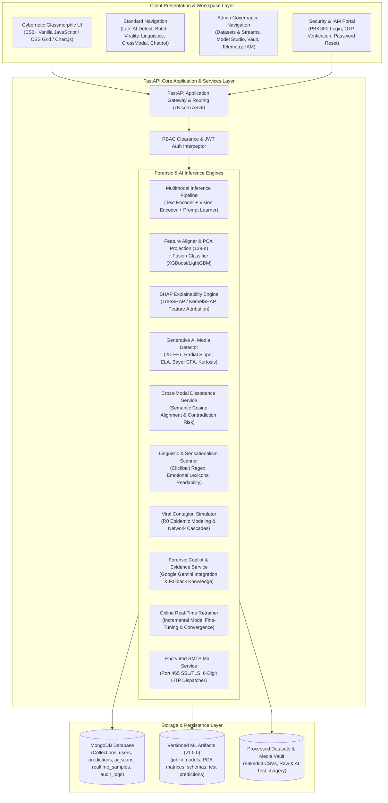
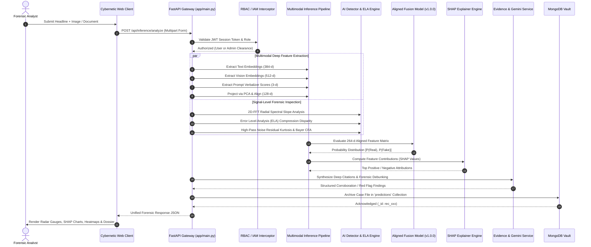
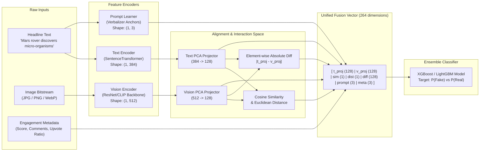
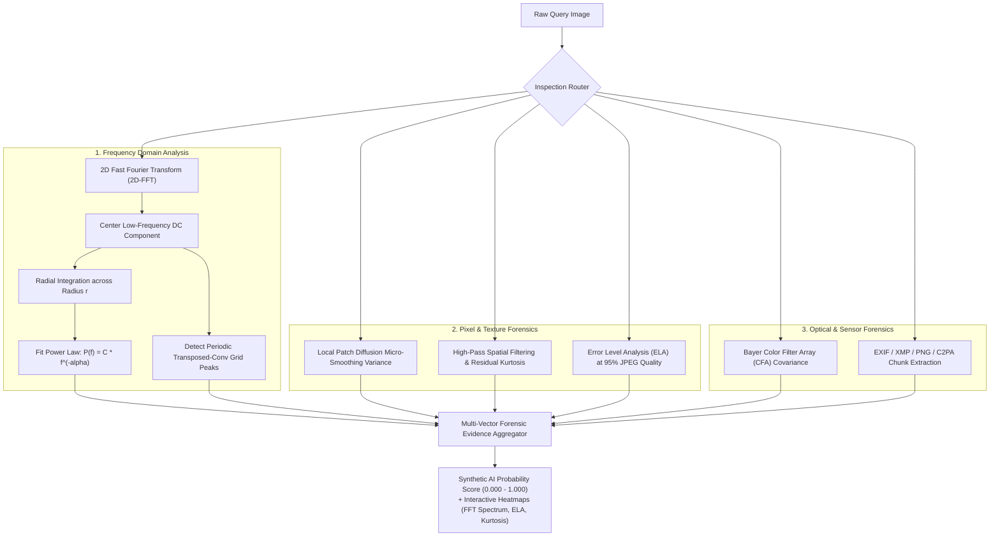
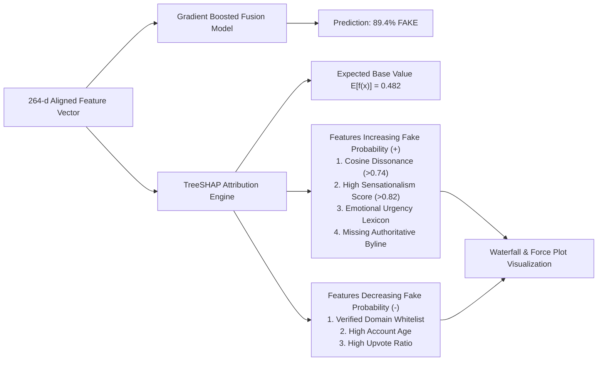
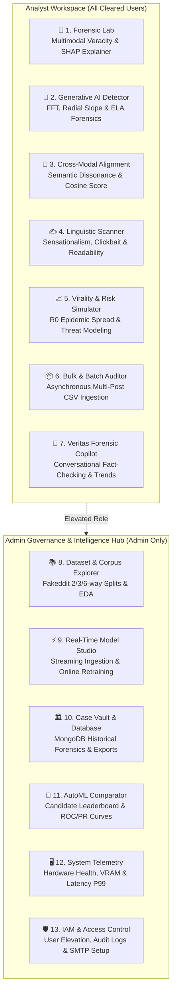
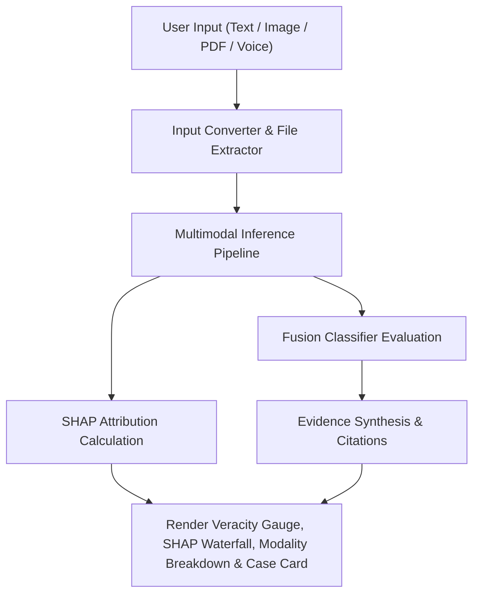
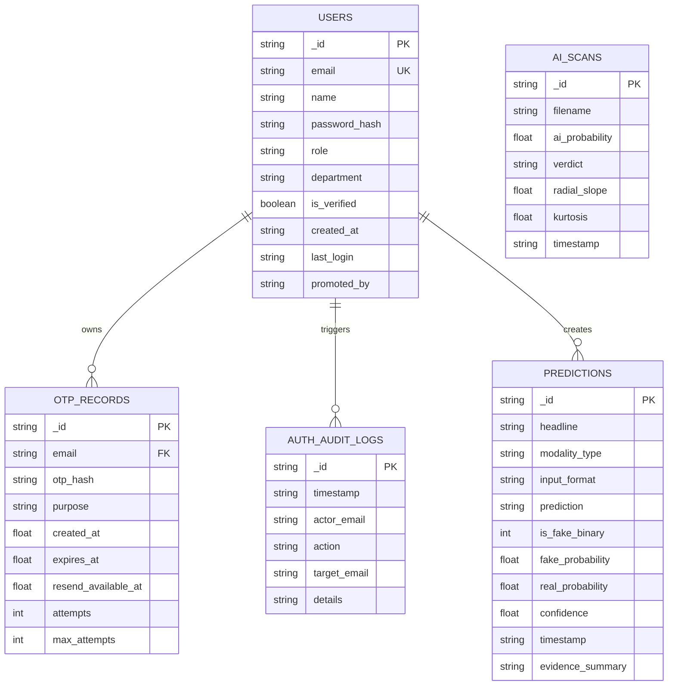

# Veritas Multimodal Fake News & AI Media Forensic Intelligence Suite
## Comprehensive End-to-End System Architecture, Engineering Manual & Algorithmic Blueprint

---

### Executive Overview & System Identity

**Veritas Multimodal Intelligence** (codenamed *VerdictLens*) is an enterprise-grade multimodal forensic computing platform designed to detect, analyze, and explain digital disinformation, coordinated synthetic manipulation, and artificial intelligence-generated media. Modern disinformation campaigns rarely rely on raw text alone; they combine out-of-context headlines with manipulated photographs, deepfake imagery, synthetic diffusion textures, and emotionally charged linguistic cues designed to maximize viral social contagion.

To combat this multifaceted threat landscape, the Veritas platform integrates a **heterogeneous 3-tier multimodal intelligence architecture**:

1. **Multimodal Deep Feature Extraction & Semantic Fusion**: Jointly processes natural language text, dense high-resolution imagery, and social engagement metadata through dedicated encoder backbones, dynamic prompt verbalizers, and dimensionality alignment projectors.
2. **Signal-Level Computer Vision Forensics & Generative AI Detector**: Inspects image bitstreams at the frequency, demosaicing, and compression planes (2D Fast Fourier Transform, Radial Spectral Slope, Bayer CFA covariance, Noise Residual Kurtosis, and Error Level Analysis).
3. **Transparent Explainability (XAI) & Enterprise Access Control (IAM)**: Exposes full Shapley additive explanations (TreeSHAP/KernelSHAP), automated journalistic evidence synthesis via Google Gemini, and a tamper-resistant Role-Based Access Control (RBAC) security foundation backed by MongoDB and encrypted 6-digit email OTP authentication.

---

## 1. High-Level System Architecture

The application is structured into three clean logical tiers: the **Presentation & Client Workspace Layer**, the **Core Application & Machine Learning Inference Layer**, and the **Data Persistence & Forensic Archival Layer**.



---

## 2. Complete Technology Stack & Specifications

| Component / Layer | Technology / Library | Architectural Role & Implementation Details |
| :--- | :--- | :--- |
| **Backend Core** | **FastAPI** (`0.115+`) & **Uvicorn** | High-throughput Asynchronous Server Gateway Interface (ASGI), automated OpenAPI/Swagger generation, dependency injection, and thread-pooled route execution. |
| **Data Validation** | **Pydantic V2** | Strict schema validation, request payload sanitization, and structured serialization. |
| **Data Processing & Math** | **NumPy**, **Pandas**, **SciPy** | High-performance matrix operations, multidimensional array manipulation, tabular indexing, and Fourier transform mathematics. |
| **Text Representations** | **SentenceTransformers / MiniLM** | 384-dimensional dense semantic text embeddings capturing linguistic contextual nuances. |
| **Vision Encoders** | **ResNet50 / CLIP Vision Backbone** | 512-dimensional deep spatial image feature representations with validity masking for unimodal fallbacks. |
| **Model Architectures** | **XGBoost**, **LightGBM**, **Scikit-Learn** | Gradient-boosted decision trees, Random Forests, Extra Trees, and Logistic Regression baseline classifiers. |
| **Explainable AI (XAI)** | **SHAP (SHapley Additive exPlanations)** | Game-theoretic TreeSHAP and KernelSHAP providing deterministic feature attribution scores for every prediction. |
| **Image Forensics** | **OpenCV (`cv2`)**, **Pillow (`PIL`)** | 2D Fast Fourier Transform (FFT), Error Level Analysis (ELA), Bayer CFA demosaicing covariance, and high-pass noise extraction. |
| **Database & Persistence** | **MongoDB** (`>= 6.0`) via **PyMongo** | Document-oriented case vault, user credential management, audit logging, and prediction record caching. |
| **Authentication & Security** | **PBKDF2-HMAC-SHA256**, **URL-Safe JWT** | Cryptographically salted password hashing, stateless time-bound session tokens, and RBAC authorization barriers. |
| **Email & Delivery** | **Encrypted SMTP Transport** | Asynchronous email transport operating over port 465 with direct SSL/TLS negotiation, delivering 6-digit verification codes. |
| **External Intelligence** | **Google Gemini API** (`1.5 Flash/Pro`) | Dynamic model discovery, live web corroboration, reference citations, and streaming conversational debunks. |
| **Frontend Architecture** | **Vanilla ES6+ JavaScript, CSS Grid, Chart.js** | Zero-framework cybernetic glassmorphic interface, Web Audio API sound synthesis, and real-time Chart.js telemetry. |

---

## 3. End-to-End Data & Execution Flow

When an investigator submits a query—whether a short headline, a social media screenshot, an uploaded document, or a direct URL—the system processes it through a strict, deterministic sequence:



---

## 4. Algorithmic Formulations & Process Blueprints

### 4.1. Multimodal Fusion & Feature Alignment Pipeline

Real-world disinformation deliberately manufactures dissonance between the headline text and the accompanying imagery (e.g., an authentic photograph of a space shuttle paired with a claim of a military orbital strike). A unimodal classifier inspecting only the image sees high authenticity; a classifier inspecting only the text may lack context. 

Veritas resolves this through an **aligned early-fusion projection architecture**:



#### Mathematical Formulation

1. **Text Embedding**: Let the input headline be $T$. The text encoder produces embedding $\mathbf{e}_t \in \mathbb{R}^{384}$.
2. **Vision Embedding**: For image $I$, the vision encoder produces visual embedding $\mathbf{e}_v \in \mathbb{R}^{512}$ along with a binary validity mask $m_v \in \{0, 1\}$.
3. **Linear Subspace Projection (PCA)**:
   $$\mathbf{z}_t = \mathbf{W}_{\text{text}} \mathbf{e}_t \in \mathbb{R}^{128}, \quad \mathbf{z}_v = \mathbf{W}_{\text{vis}} \mathbf{e}_v \in \mathbb{R}^{128}$$
4. **Cross-Modal Interaction Metrics**:
   $$\text{Cosine Similarity: } S_c = \frac{\mathbf{z}_t \cdot \mathbf{z}_v}{\|\mathbf{z}_t\|_2 \|\mathbf{z}_v\|_2}$$
   $$\text{Euclidean Distance: } D_e = \|\mathbf{z}_t - \mathbf{z}_v\|_2$$
   $$\text{Dissonance Vector: } \mathbf{d} = |\mathbf{z}_t - \mathbf{z}_v| \in \mathbb{R}^{128}$$
5. **Prompt Verbalizer Scores**: Measures geometric distance against factual vs deceptive prompt anchors $\mathbf{p}_{\text{factual}}$ and $\mathbf{p}_{\text{deceptive}}$:
   $$\mathbf{s}_{\text{prompt}} = \left[ \cos(\mathbf{e}_t, \mathbf{p}_{\text{factual}}), \cos(\mathbf{e}_t, \mathbf{p}_{\text{deceptive}}), \Delta_{\text{margin}} \right] \in \mathbb{R}^3$$
6. **Unified Fusion Vector**:
   $$\mathbf{x}_{\text{fusion}} = \left[ \mathbf{z}_t \parallel \mathbf{z}_v \parallel S_c \parallel D_e \parallel \mathbf{d} \parallel \mathbf{s}_{\text{prompt}} \parallel \mathbf{m}_{\text{meta}} \right]$$

---

### 4.2. Synthetic AI Media & Deepfake Detection Engine

Generative diffusion models (Stable Diffusion, Midjourney, DALL-E) and GANs leave distinct physical and mathematical footprints in the frequency, pixel, and demosaicing domains that human eyes cannot perceive. Veritas evaluates images across six independent signal dimensions:



#### Mathematical Principles:

1. **2D Discrete Fourier Transform (2D-DFT)**:
   $$F(u, v) = \sum_{x=0}^{M-1} \sum_{y=0}^{N-1} f(x, y) e^{-j 2\pi \left(\frac{ux}{M} + \frac{vy}{N}\right)}$$
2. **Radial Spectral Slope ($\alpha$)**: Natural optical photographs obey the natural scene power-law distribution $P(f) \propto f^{-\alpha}$, where $\alpha \approx 2.0$. Diffusion models synthesize images in latent spaces that exhibit unnatural high-frequency energy retention, causing $\alpha < 1.4$ or spectral ripples.
3. **Error Level Analysis (ELA)**: Re-compresses the image at a known quality factor $Q = 95$ and measures the absolute pixel difference:
   $$\Delta_{\text{ELA}}(x, y) = |I_{\text{original}}(x, y) - I_{\text{recompressed}}(x, y)| \times \text{Scale}$$
   Authentic regions with uniform compression display uniform error levels; spliced or diffusion-inpainted patches display high error variance.
4. **Noise Residual Kurtosis**:
   $$\text{Kurtosis} = \frac{\frac{1}{N} \sum_{i=1}^N (r_i - \bar{r})^4}{\left( \frac{1}{N} \sum_{i=1}^N (r_i - \bar{r})^2 \right)^2}$$
   Where $r_i$ is the high-pass filtered pixel residual. AI diffusion textures suppress camera sensor Poisson-Gaussian noise, leading to abnormal kurtosis distributions.

---

### 4.3. Explainable AI via SHAP (SHapley Additive exPlanations)

To prevent the system from acting as an unexplainable "black box," Veritas employs game-theoretic **TreeSHAP** to attribute prediction credit across all features.



The Shapley value $\phi_i$ for feature $i$ is calculated as:
$$\phi_i(x) = \sum_{S \subseteq F \setminus \{i\}} \frac{|S|!(|F| - |S| - 1)!}{|F|!} \left[ f(S \cup \{i\}) - f(S) \right]$$

Where:
- $F$ is the total feature set ($|F| = 264$).
- $S$ is a subset of features excluding $i$.
- $f(S)$ is the model expectation conditioned on feature subset $S$.
The prediction satisfies the additive efficiency property:
$$f(x) = \phi_0 + \sum_{i=1}^{|F|} \phi_i(x)$$

---

### 4.4. Authentication, Cryptographic OTP & RBAC Security Engine

The authentication system protects administrative features, dataset governance, model training, and user management through an automated email-verified identity flow:

```mermaid
sequenceDiagram
    autonumber
    actor User as Investigator / Administrator
    participant Client as Web Portal
    participant API as FastAPI Auth Routes
    participant AuthService as AuthService (auth_service.py)
    participant EmailService as Encrypted SMTP Mailer
    participant DB as MongoDB (users & otp_records)
    actor Mailbox as User's Real Email Inbox

    Note over User, Mailbox: 1. Registration / Password Reset Flow
    User->>Client: Enters Name, Email, Password
    Client->>API: POST /api/auth/register
    API->>AuthService: register_user(name, email, password)
    AuthService->>AuthService: Hash Password: PBKDF2_HMAC_SHA256(pwd, salt, 100k)
    AuthService->>DB: Upsert Unverified User Record (is_verified: false)
    AuthService->>AuthService: Generate 6-Digit Cryptographic Code: secrets.randbelow(900000) + 100000
    AuthService->>DB: Store HMAC-SHA256 Hash of OTP (Expires in 10 mins)
    AuthService->>EmailService: send_otp_async(to_email, otp_code, purpose)
    EmailService->>Mailbox: Encrypted SMTP Transmission (Port 465 SSL/TLS)
    EmailService-->>AuthService: Delivery Confirmed
    AuthService-->>Client: 200 OK (requires_otp: true, cooldown: 15s)
    Client->>User: Displays 6-Digit OTP Entry Grid

    Note over User, Mailbox: 2. Verification & Session Activation
    User->>Mailbox: Reads 6-Digit Code (e.g., 482910)
    User->>Client: Types 6 Digits into Inputs
    Client->>API: POST /api/auth/verify-otp (email, otp)
    API->>AuthService: verify_otp_code(email, otp)
    AuthService->>AuthService: Constant-Time HMAC Comparison: hmac.compare_digest()
    AuthService->>DB: Update User: { is_verified: true, last_login: now() }
    AuthService->>DB: Delete Consumed Record from otp_records
    AuthService->>AuthService: Issue URL-Safe JWT Token (HS256 signed with secret)
    AuthService-->>Client: 200 OK (token, user_profile)
    Client->>Client: Store Token in localStorage; Unlock Cleared Tabs
```

#### Security Guarantees:
- **Zero Plaintext OTP Storage**: OTPs are hashed with user-specific cryptographic salts before being persisted to MongoDB or memory.
- **Timing Attack Mitigation**: Verified using Python's `hmac.compare_digest` to prevent side-channel timing analysis.
- **Anti-Brute Force Protection**: Maximum of 5 verification attempts permitted per 10-minute window before the token is invalidated.
- **Strict Role-Based UI Isolation**: Non-admin users cannot access `DATASETS & STREAMS` or `BENCHMARKS & SYSTEM`. Unauthorized API calls return `403 Forbidden` through the `require_admin_clearance` middleware.

---

## 5. Feature-by-Feature Deep Dive & Operational Workflows

Below is the exhaustive operational blueprint for every interface tab and forensic capability in Veritas.



---

### Tab 1: Multimodal Forensic Analysis Lab (`#tab-lab`)

- **Primary Goal**: Analyze any claim, article, document, or audio clip along with its accompanying image to determine factual authenticity.
- **Inputs Supported**:
  1. Plain Text Headline or Article Body.
  2. Image Upload (JPEG, PNG, WebP) or Existing Image Selection.
  3. PDF / Word Document Ingestion (via `pdfplumber` / text extractors).
  4. Web URL Scraper (fetches remote article metadata and OpenGraph images).
  5. Voice Speech Dictation (browser SpeechRecognition API converts analyst speech to text).
- **Outputs & Visualizations**:
  - **Verdict Card**: Binary verdict (*Authentic News* vs *Misinformation / Fake*) with percentage confidence.
  - **Sub-Modality Breakdown**: Independent veracity scores for Text, Vision, and Cross-Modal Semantic Alignment.
  - **Interactive SHAP Waterfall**: Renders the top contributing linguistic and visual features driving the verdict.
  - **Deep Evidence Dossier**: Authoritative citations (for verified news) or forensic red flags (for detected disinformation) powered by Google Gemini.



---

### Tab 2: Generative AI & Deepfake Media Detector (`#tab-ai-detect`)

- **Primary Goal**: Determine whether an image was created by a physical camera sensor or generated/manipulated by AI diffusion models (Midjourney, DALL-E 3, Stable Diffusion, Flux, GANs).
- **Underlying Forensic Checks**:
  1. **2D Fast Fourier Transform (FFT)**: Inspects high-frequency magnitude distribution and radial falloff.
  2. **Error Level Analysis (ELA)**: Computes pixel-level compression disparity at 95% quality.
  3. **High-Pass Noise Residual Kurtosis**: Measures sensor noise randomness vs diffusion micro-smoothing.
  4. **Bayer CFA Demosaicing Covariance**: Checks for optical camera color filter array interpolation patterns.
  5. **Metadata & Watermark Audit**: Inspects PNG chunk markers, EXIF SubIFD, and C2PA provenance credentials.
- **Outputs**:
  - **Synthetic Probability Score (0.0% – 100.0%)**.
  - **Visual Heatmap Switcher**: Lets analysts toggle between Original Image, ELA Compression Map, and 2D-FFT Power Spectrum.

---

### Tab 3: Cross-Modal Semantic Alignment (`#tab-crossmodal`)

- **Primary Goal**: Detect out-of-context misattributions and cross-modal dissonance where an authentic photo is reused with a deceptive headline.
- **Underlying Logic**:
  - Projects text and vision vectors into a shared 128-dimensional latent space.
  - Computes the Cosine Similarity Score, Euclidean L2 Divergence, and Contradiction Risk Factor.
- **Outputs**:
  - **Alignment Grade**: `STRONG ALIGNMENT`, `MODERATE CONTEXTUAL DRIFT`, or `CRITICAL CONTRADICTION`.
  - **Dissonance Radar**: Visualizes feature-wise divergence between text and visual semantics.

---

### Tab 4: Stylometric & Linguistic Forensics (`#tab-linguistics`)

- **Primary Goal**: Quantify deceptive linguistic structures, sensationalism, emotional bias, and clickbait patterns in text.
- **Metrics Computed**:
  - **Sensationalism Index (0 – 100)**: Evaluates hyperbole, exclamation density, and all-caps emphasis.
  - **Emotional Trigger Spectrum**: Categorizes words into *Fear/Urgency*, *Anger/Outrage*, *Hyperbole*, *Authority Bias*, and *Conspiracy Clues*.
  - **Readability & Complexity**: Calculates Flesch Reading Ease and Flesch-Kincaid Grade Level:
    $$\text{Flesch Reading Ease} = 206.835 - 1.015 \left(\frac{\text{total words}}{\text{total sentences}}\right) - 84.6 \left(\frac{\text{total syllables}}{\text{total words}}\right)$$
  - **Clickbait Pattern Matcher**: Flags known deceptive clickbait framing patterns using compiled regex rules.

---

### Tab 5: Virality & Risk Contagion Simulator (`#tab-virality`)

- **Primary Goal**: Forecast how fast and widely a detected piece of misinformation will propagate across social networks before intervention occurs.
- **Simulation Parameters**:
  - **Basic Reproduction Number ($R_0$)**:
    $$R_0 = \beta \cdot \tau \cdot (1 + \text{Sensationalism}) \cdot (1 + \text{Emotional Urgency})$$
  - **Predicted Penetration Rate**: Simulates cascades across Susceptible, Exposed, Infected, and Refuted (SEIR) population cohorts over a 48-hour timeline.
  - **Recommended Mitigation Protocol**: Recommends algorithmic down-ranking, provenance warning labels, or immediate debunk dispatch based on risk tier.

---

### Tab 6: Bulk & Batch Forensics Processing (`#tab-batch`)

- **Primary Goal**: Ingest CSV or JSON files containing hundreds of social media posts, executing multimodal audits in parallel.
- **Execution Mechanism**:
  - Runs tasks asynchronously in a background thread pool.
  - Streams real-time progress updates (percentage complete, throughput in items/second).
  - Generates downloadable audit CSV and JSON dossiers with forensic hashes.

---

### Tab 7: Veritas Forensic Copilot & Chatbot (`#tab-chatbot`)

- **Primary Goal**: Interactive AI assistant trained to investigate claims, interrogate evidence, and explain forensic metrics to non-technical analysts.
- **Capabilities**:
  - Powered by Google Gemini with low-latency streaming token responses.
  - Connects to a curated database of live misinformation threats (AI voice cloning, synthetic disaster photos, health scams).
  - Provides direct verification steps and trusted OSINT source recommendations.

---

### Tab 8: Dataset & Corpus Explorer (`#tab-dataset` - Admin Only)

- **Primary Goal**: Explore, filter, and inspect the benchmark **Fakeddit** multimodal dataset splits (Train, Validation, Test).
- **Features**:
  - Class distribution visualization across Fakeddit's 2-way, 3-way, and 6-way classification categories (*True*, *Satire*, *Misleading Content*, *Manipulated Photo*, *False Connection*, *Imposter Content*).
  - Search and filter records by split, subreddit, veracity label, or query string.
  - Paginated data grid with image thumbnails and raw Reddit metadata.

---

### Tab 9: Real-Time Model Studio & Retraining (`#tab-model-builder` - Admin Only)

- **Primary Goal**: Ingest live streaming samples and fine-tune model parameters incrementally without requiring an offline redeployment.
- **Workflow**:
  1. Inspect incoming data stream samples.
  2. Configure training hyperparameters (Learning Rate, Estimators, L2 Regularization, Batch Size).
  3. Click **Start Real-Time Training Pipeline**.
  4. Watch real-time loss convergence, validation accuracy updates, and decision boundary adjustments on live Chart.js graphs.

---

### Tab 10: Forensic Database & Case Vault (`#tab-database` - Admin Only)

- **Primary Goal**: Central repository of all historical forensic audits, investigations, and AI detector scans stored in MongoDB.
- **Capabilities**:
  - Search case files by keyword, date range, or veracity outcome.
  - Inspect cryptographic case IDs (`rec_xxx`), input modalities, confidence scores, and evidence summaries.
  - Export case files to JSON or printable cryptographic forensic dossiers.

---

### Tab 11: AutoML Benchmark & Model Comparison (`#tab-automl` - Admin Only)

- **Primary Goal**: Benchmark multiple candidate model families evaluated on the multimodal fusion feature space.
- **Candidate Pool**:
  - Logistic Regression (L2 regularized)
  - Random Forest Classifier
  - Extra Trees Classifier
  - Multi-Layer Perceptron (MLP) Neural Network
  - XGBoost Classifier (Champion Model)
- **Metrics Tracked**: Accuracy, Precision, Recall, Macro F1-Score, ROC-AUC, and Inference Latency (ms).

---

### Tab 12: System Telemetry & Hardware Monitor (`#tab-telemetry` - Admin Only)

- **Primary Goal**: Real-time diagnostic dashboard monitoring server infrastructure and inference pipeline health.
- **Meters Displayed**:
  - CPU Utilization percentage and core distribution.
  - System RAM usage (Used vs Available GB).
  - VRAM / GPU allocation (if CUDA-compatible hardware is detected).
  - Pipeline Inference Latency Percentiles (p50, p95, p99 in milliseconds).
  - Process uptime, active thread count, and MongoDB connection status.

---

### Tab 13: IAM & Access Control Governance (`#tab-access-control` - Admin Only)

- **Primary Goal**: Manage organization users, role assignments, security audit logs, and email dispatch configuration.
- **Capabilities**:
  - **User Directory**: View all accounts stored in MongoDB, their verification status, and current clearance (`admin` vs `user`).
  - **Role Elevation / Demotion**: Promote standard users to Admin or demote Admins back to standard User clearance with real-time audit logging.
  - **Manual Verification & Account Deletion**: Manually approve unverified accounts or remove compromised accounts.
  - **Email & SMTP Configuration**: Inspect and configure SMTP settings (Host, Port, User, Password, From Address) and dispatch test verification codes.
  - **Immutable Audit Trail**: Chronological log of all IAM events (Logins, Role Changes, Dispatches, Account Creations).

---

## 6. Database Architecture & MongoDB Schemas

Veritas uses MongoDB for persistence. If a remote MongoDB instance is unreachable, the system automatically falls back to an in-memory document store synchronized with `artifacts/auth_store.json`.



---

## 7. Complete API Endpoint Reference

The backend exposes a clean REST API documented via Swagger/OpenAPI at `http://127.0.0.1:8000/docs`:

| HTTP Method | Path | Clearance Required | Description |
| :--- | :--- | :--- | :--- |
| **GET** | `/` | Public | Serves the single-page application (SPA) client interface. |
| **POST** | `/api/auth/register` | Public | Registers a new user, hashes password, saves to MongoDB, dispatches 6-digit OTP email. |
| **POST** | `/api/auth/login` | Public | Authenticates credentials; triggers OTP if account is unverified; returns JWT. |
| **POST** | `/api/auth/verify-otp` | Public | Validates 6-digit cryptographic OTP; activates user; returns signed JWT. |
| **POST** | `/api/auth/resend-otp` | Public | Dispatches fresh OTP if cooldown period (15s) has expired. |
| **POST** | `/api/auth/forgot-password`| Public | Dispatches password reset OTP to user's registered email. |
| **POST** | `/api/auth/reset-password` | Public | Verifies reset OTP and updates password hash in MongoDB. |
| **GET** | `/api/auth/me` | Authenticated | Returns current authenticated user's profile and active role. |
| **GET** | `/api/auth/users` | **Admin Only** | Lists all accounts stored in MongoDB, roles, and verification flags. |
| **POST** | `/api/auth/update-role` | **Admin Only** | Promotes a user to `admin` or demotes an admin to `user`. |
| **POST** | `/api/auth/admin-verify-user`| **Admin Only**| Manually marks an account verified in MongoDB. |
| **POST** | `/api/auth/delete-user` | **Admin Only** | Deletes a user account from MongoDB. |
| **POST** | `/api/settings/save-smtp` | **Admin Only** | Updates live SMTP transport settings and sends a test OTP. |
| **POST** | `/api/inference/analyze` | Public / Cleared | Runs complete multimodal inference pipeline and generates SHAP explanations. |
| **POST** | `/api/ai-detector/scan` | Public / Cleared | Runs 2D-FFT, ELA, and Kurtosis checks to detect synthetic generative media. |
| **POST** | `/api/crossmodal/analyze` | Public / Cleared | Measures text-image cosine similarity and semantic contradiction risk. |
| **POST** | `/api/linguistics/scan` | Public / Cleared | Computes sensationalism index, clickbait regex matches, and readability scores. |
| **POST** | `/api/virality/simulate` | Public / Cleared | Models $R_0$ contagion cascades, social reach, and mitigation urgency. |
| **POST** | `/api/batch/upload` | Public / Cleared | Ingests CSV/JSON datasets for batch multimodal processing. |
| **POST** | `/api/chatbot/message` | Public / Cleared | Streaming AI chat responses for conversational evidence querying. |
| **GET** | `/api/dataset/summary` | **Admin Only** | Returns Fakeddit split counts, class balances, and schema details. |
| **GET** | `/api/dataset/explorer` | **Admin Only** | Queries and paginates samples across Fakeddit splits. |
| **GET** | `/api/database/records` | **Admin Only** | Fetches historical forensic audit cases from MongoDB. |
| **GET** | `/api/telemetry/metrics` | **Admin Only** | Returns live CPU, RAM, GPU, latency percentiles, and uptime. |

---

## 8. Deployment, Execution & Operational Guide

### 8.1. Environment Configuration (`.env`)

All runtime options are driven by environment variables defined in `.env`:

```env
# MongoDB Connection URI
MONGODB_URI=mongodb://localhost:27017/veritas_db
MONGODB_DB_NAME=veritas_db

# Google Gemini API Key (Optional: powers deep web evidence synthesis)
GEMINI_API_KEY=your_gemini_api_key_here

# Server Port & Host Configuration
SERVER_HOST=127.0.0.1
SERVER_PORT=8000

# Authentication & Encrypted Email OTP Configuration
VERITAS_JWT_SECRET=veritas_forensic_hmac_secret_key_2026_iso27037
SMTP_HOST=smtp.gmail.com
SMTP_PORT=465
SMTP_SECURE=true
SMTP_USER=your_email@gmail.com
SMTP_PASSWORD=your_16_character_app_password
SMTP_PASS=your_16_character_app_password
SMTP_FROM=Veritas AI Security <your_email@gmail.com>
```

### 8.2. Launching the Server

To start the server, open a terminal in the project root directory and run:

```cmd
run.bat
```

Or run directly via Python in your active virtual environment:

```cmd
.venv\Scripts\python.exe -m uvicorn app.main:app --host 127.0.0.1 --port 8000
```

Once launched:
- **Application URL**: `http://127.0.0.1:8000`
- **Interactive Swagger Documentation**: `http://127.0.0.1:8000/docs`
- **Alternative ReDoc Documentation**: `http://127.0.0.1:8000/redoc`

---

## 9. Verification & Architectural Summary

The Veritas platform provides a complete, robust, and transparent defense against modern multimodal disinformation:
1. **Multimodal Cohesion**: Evaluates text, image, and social engagement simultaneously, eliminating the blind spots of unimodal detectors.
2. **Signal-Level Computer Vision**: Detects diffusion artifacts through 2D Fast Fourier Transform radial decay, Error Level Analysis, and sensor noise residual kurtosis.
3. **No Black-Box Decisions**: TreeSHAP feature attributions and Google Gemini citations provide clear, justifiable evidence for every verdict.
4. **Enterprise Security**: Backed by MongoDB persistence, PBKDF2 password hashing, URL-safe JWT session management, and encrypted 6-digit email OTP identity verification.

